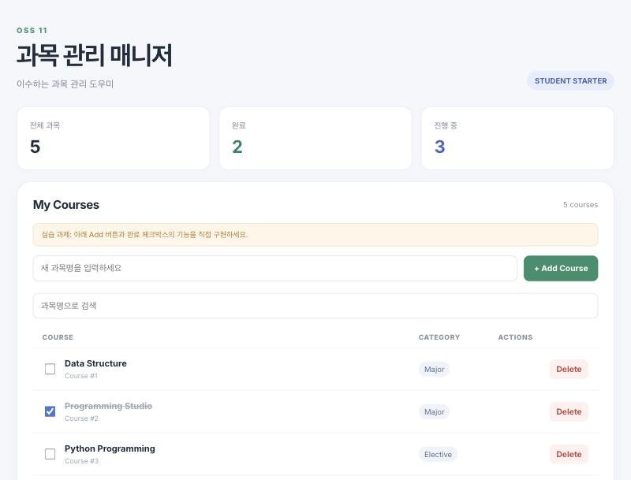

## 프로젝트 정보
### 프로젝트 소개
- React를 이용하여 과목 정보를 CRUD 하는 간단한 프로그램이다.

### 주요 기능
- 과목 이름을 입력하고 과목을 추가하면 목록에 추가된다.
- Delete 버튼으로 과목 삭제가 가능하다.
- 완료한 과목을 체크하면 완료 표시로 바뀐다.

### 원본 샘플 URL 
https://github.com/2026-2-OSS/week11_sample_project

### 배포 URL
https://week11-sample-project-six.vercel.app/

## 설치 방법
Node.js 20.19+ 또는 22.12+ 권장.

```bash
npm install
npm run dev
```

브라우저에 표시되는 Local URL에 접속하세요. 빌드 테스트: `npm run build`.




## 소스코드 설명
### 주요 파일 3개의 역할

1. CourseItem.jsx : 부모 CourseList.jsx로부터 props을 상속받는 컴포넌트로, course 정보를 표시하는 기능을 담당한다.
2. CourseList.jsx : 메인화면을 담당하는 파일로, 생성된 course를 화면에 표시하는 기능을 담당한다.
3. courses.js : JavaScript 코드로 이루어진 데이터 파일로, 초기 데이터가 등록되어 있다.


### 컴포넌트 & Props
CourseList.jsx에서 콜백 함수를 이용하여 자식 CourseItem.jsx에 props를 넘긴다. 자식 CourseItem.jsx는 받아온 정보와 함수를 이용하여 처리하고, 다시 부모 컴포넌트에 정보를 전달한다.

### state & event
useState로 과목 목록을 상태로 관리하며, 상태가 바뀌면 화면도 자동으로 갱신된다.
삭제 버튼을 클릭하면 자식 CourseItem이 부모에게 받은 삭제 함수를 과목 id와 함께 호출한다.
부모는 삭제 확인 후 해당 과목을 제외한 새 목록으로 상태를 변경하여 화면에서 과목을 제거한다.

### Code Analysis
```jsx
const [courses, setCourses] = useState(initialCourses);

function handleDelete(id) {
  if (!window.confirm('이 과목을 삭제하시겠습니까?')) return;
  setCourses(previous => previous.filter(course => course.id !== id));
}
```

`courses`는 현재 과목 목록이고, `setCourses`는 목록을 변경하는 함수이다. 삭제를 확인하면 `filter`로 해당 id의 과목을 제외한 새 배열을 만든다. 이 배열로 상태를 변경하면 React가 화면을 다시 렌더링하여 삭제 결과를 보여준다.

```jsx
// CourseList.jsx: 각 과목의 정보와 콜백 함수를 자식에게 전달
{courses.map(course => (
  <CourseItem key={course.id} course={course} onDelete={handleDelete} onToggle={handleToggle} />
))}

// CourseItem.jsx: 삭제 버튼을 클릭하면 해당 과목의 id로 콜백 호출
<button className="btn danger" type="button" onClick={() => onDelete(course.id)}>
  Delete
</button>
```

`map`은 과목마다 `CourseItem`을 만들고, `course`와 콜백 함수를 props로 전달한다. 자식의 삭제 버튼을 클릭하면 `onDelete(course.id)`를 통해 부모의 `handleDelete`가 실행된다.

## 커스터마이징
### 수정한 데이터
- src/data/courses.js
- 1번 과목: Open Source Studio (Major) → Data Structure (Major)
- 2번 과목: Programming Studio (Major, 완료) → 그대로 유지
- 3번 과목: Coding Studio (Elective) → Python Programming (Elective)
- 4번 과목: Web Service Development (Major) → 서양의 역사와 문화 (Elective)
- 5번 과목: Software Engineering (Elective, 완료) → Discrete Mathematics (Major, 완료)

### 수정한 텍스트
- src/App.jsx
- 윗줄 문구: OPEN SOURCE STUDIO · WEEK 11 → OSS 11
- 제목: My Course Manager → 과목 관리 매니저
- 부제: React Component, Props & State Practice → 이수하는 과목 관리 도우미

### 수정한 CSS
- src/App.css
- .topline(제목 위 작은 글자) 색: #4b71ce 파랑 → #2f8f6b 초록
- .btn.primary(Add 버튼) 배경색: #496fd3 → #2f8f6b
- .btn.primary:hover(Add 버튼에 마우스를 올렸을 때) 배경색: #365bb7 → #23714f
- .panel(과목 목록 박스) 모서리 둥글기: 18px → 24px


## 주요 코드
### 추가한 기능
1. 과목 등록
```jsx
function handleAdd(event) {
  event.preventDefault();
  const name = newName.trim();
  if (name === '') {
    return;
  }
  const newCourse = {
    id: Math.max(0, ...courses.map(course => course.id)) + 1,
    name,
    category: 'Major',
    completed: false,
  };
  setCourses(previous => [...previous, newCourse]);
  setNewName('');
  setError('');
}
```

- trim()으로 앞뒤 공백을 지우고, 빈 값이면 등록하지 않게 한다.
- id는 지금 목록에서 가장 큰 id에 1을 더하여 결정한다.
- spread([...previous, newCourse])로 새 배열을 만들어 state를 바꾼다.
- 검증 결과 : Operating System을 입력하면 Course #6으로 목록 맨 아래에 추가되고, 통계가 6/2/4로 바로 바뀐다. 빈 칸이나 공백만 입력하면 등록되지 않는다.


2. 과목 완료 상태 변경
```jsx
function handleToggle(id) {
  setCourses(previous =>
    previous.map(course =>
      course.id === id ? { ...course, completed: !course.completed } : course
    )
  );
}
```

- map으로 새 배열을 만들고, 클릭한 id의 과목만 spread({ ...course })로 복사한 뒤 completed 값을 반대로 바꾼다.
- 나머지 과목은 그대로 두기 때문에 원본 state를 직접 수정하지 않는다.
- CourseItem.jsx의 체크박스를 누르면 onToggle(course.id)로 부모의 handleToggle이 실행된다.
- 검증 결과 : 체크하면 취소선이 생기고 통계가 6/3/3으로 바뀌고, 다시 누르면 미완료로 변경된다.


3. 과목명 검색
```jsx
const [searchText, setSearchText] = useState('');

const visibleCourses = courses.filter(course =>
  course.name.toLowerCase().includes(searchText.trim().toLowerCase())
);
```

- 원본 courses는 그대로 두고, 화면에는 filter로 고른 visibleCourses만 그린다.
- 검색 결과가 없으면 "검색 결과가 없습니다."로 표시된다.
- 검증 결과: PRO를 검색하면 Programming Studio와 Python Programming가 표시된다.

## Weekly Review
### 새롭게 배운 내용 3가지
1. State 불변성
React에서는 state를 직접 수정하지 않고, 새로운 배열이나 객체를 만들어 변경해야 한다.

2. 고유한 ID와 Key
React에서 리스트를 렌더링할 때 각 요소에는 고유한 key가 필요하다.

3. 파생 데이터
기존 state로 계산할 수 있는 값은 별도의 state로 저장하지 않는 것이 좋다.

### 어려웠던 점과 해결 방법
- 지난 주에 이어 이번 주도 문법 공부하는 것이 어려워 AI와 함께 공부하며 react 문법을 하나하나 익혔다. 특히 함수를 작성하는 것이 어려웠다.

### AI 활용 내용 및 느낀 점
- 문법 공부할 때 주로 사용하였다. 또한 관련 개념들을 학습할 때 AI에게 물어보는 용도로도 활용하였다. AI랑 같이 공부하니 쉽게쉽게 공부할 수 있어 좋은 것같다.
